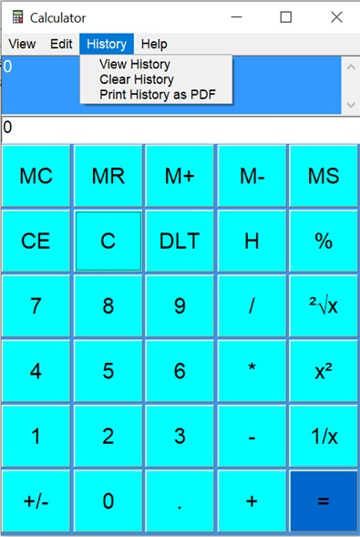
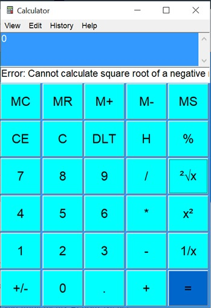

# Calculator

A desktop calculator application developed in Java using a graphical user interface (GUI). The project provides basic arithmetic functionality and is structured as a NetBeans Java project for straightforward compilation and execution.

## Overview

This project implements a calculator application with a Java Swing-based graphical interface. It is intended as an educational software-engineering project demonstrating GUI development, event-driven programming, and modular source-code organization in Java.

The repository includes the application source code, NetBeans project configuration, build files, and a project history document.

## Features

- Graphical calculator interface
- Basic arithmetic operations
- Event-driven user interaction
- Java-based desktop implementation
- NetBeans project structure
- Build support through Apache Ant (`build.xml`)

### Screenshots

|                  Standard                  |                  History                    |
| :----------------------------------------: | :-----------------------------------------: |
|         |            |
|                  Errors                    |                  Print                      |
|             |                |

## Technology Stack

| Component | Technology |
|---|---|
| Programming language | Java |
| User interface | Java Swing / AWT |
| IDE | Apache NetBeans |
| Build tool | Apache Ant |
| Project type | Desktop application |

## Project Structure

```text
Calculator/
├── src/
│   └── gui/               # GUI and application source code
├── build/
│   └── classes/           # Compiled Java classes
├── lib/                   # Project libraries, if applicable
├── nbproject/             # NetBeans project configuration
├── build.xml              # Apache Ant build script
├── manifest.mf            # Java application manifest
├── CalculatorHistory.pdf  # Project history/documentation
└── .gitattributes         # Git configuration
```

## Requirements

Before building or running the project, ensure the following software is installed:

- Java Development Kit (JDK) 8 or later
- Apache NetBeans, preferably version 12.0 or later
- Apache Ant, if building from the command line

## Setup and Installation

1. Clone the repository:

   ```bash
   git clone https://github.com/DhanikaJ/Calculator.git
   cd Calculator
   ```

2. Open Apache NetBeans.

3. Select **File → Open Project**.

4. Navigate to the cloned `Calculator` directory and open the project.

5. Wait for NetBeans to resolve the project configuration.

## Running the Application

### Using NetBeans

1. Open the project in Apache NetBeans.
2. Right-click the project in the **Projects** panel.
3. Select **Run**.

### Using the Command Line

If Apache Ant is installed, run:

```bash
ant run
```

Alternatively, compile and run the application manually after locating the main class:

```bash
javac -d build/classes src/gui/*.java
java -cp build/classes gui.Main
```

> Note: Replace `gui.Main` with the actual fully qualified name of the application’s main class if it differs.

## Building the Project

To compile the project using Apache Ant:

```bash
ant clean
ant build
```

The compiled classes will be generated in the `build/classes` directory.

## Usage

1. Launch the calculator application.
2. Enter numeric values using the on-screen buttons or keyboard input, depending on the interface implementation.
3. Select an arithmetic operation.
4. View the calculated result in the display area.
5. Clear the display to begin a new calculation.

## Code Organization

The application source code is organized under the `src/gui` package. This structure separates the graphical interface and application logic from project configuration files, supporting maintainability and readability.

## Documentation

`CalculatorHistory.pdf` contains project-related history and documentation. It can be used to understand the development process, design decisions, and evolution of the application.

## Future Enhancements

Possible improvements include:

- Scientific functions such as square root, percentage, power, and trigonometry
- Calculation history
- Keyboard shortcut support
- Unit tests for arithmetic logic
- Improved error handling for invalid input and division by zero
- Dark mode and improved UI accessibility
- Cross-platform executable packaging

## Author

**DhanikaJ**  
GitHub: [https://github.com/DhanikaJ](https://github.com/DhanikaJ)
